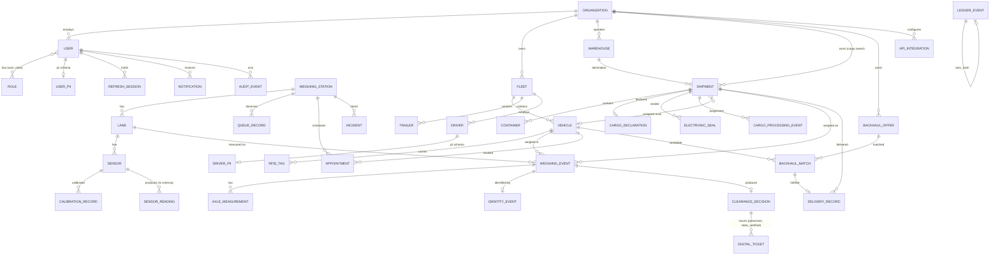

# KIFARU PORTOS — Database Design

PostgreSQL 16. Three schemas: `core` (operational), `pii` (personal data, separate DB role, application-level
encryption of sensitive columns), `ts` (high-rate time-series: decimated sensor readings, partitioned monthly).
All tables carry `created_at`, `updated_at`. IDs are 26-character ULIDs stored as `CHAR(26)` (edge-generated, sortable).
Monetary values are `NUMERIC(14,2)` KES. Weights are integers in **kilograms**; distances in metres; speeds in m/s.
Authoritative definition: `apps/api/kifaru/models/*.py`; migration `apps/api/alembic/versions/0001_initial.py`.

## 1. Entity-relationship diagram

## 2. Table catalogue

| Table | Purpose | Key columns / constraints | Indexes |
|---|---|---|---|
| `core.organizations` | Transporter, cargo owner, warehouse operator, regulator, platform | `type`, `status` | `(type)`, `(name)` |
| `core.users` | Accounts | `email` unique, `password_hash` (Argon2id), `mfa_secret`, `mfa_enabled`, `org_id` FK, `is_active`, `failed_logins`, `locked_until` | `(org_id)` |
| `core.roles`, `core.user_roles` | RBAC | ten roles (`ROLE_NAMES`) | — |
| `core.refresh_sessions` | Rotating refresh tokens | `token_hash` unique (sha256), `expires_at`, `revoked_at`, `mfa_verified` | `(user_id)` |
| `core.fleets` | Vehicle groups | `org_id` FK | `(org_id)` |
| `core.vehicles` | Trucks | `plate` unique, `plate_norm` (upper, alphanumeric — ANPR matching), `axle_config` (e.g. `1+2+3`), `tare_kg`, `max_gvm_kg`, `payload_capacity_kg`, `body_type`, `last_lat/lon/seen_at`, `watchlist_reason` | `(plate)`, `(plate_norm)`, `(fleet_id)`, `(org_id)` |
| `core.trailers` | Semi-trailers | `plate` unique, `axle_config`, `tare_kg` | `(plate)` |
| `core.rfid_tags` | UHF EPC → vehicle | `epc` unique, `revoked_at` | `(epc)`, `(vehicle_id)` |
| `core.drivers` | Driver operational data | `license_class`, `hours_driven_today_s`, `user_id?` | `(org_id)` |
| `core.weighing_stations` | Mariakani, Athi River, Gilgil, port gate | `code` unique, `lat/lon`, `capacity_per_hour`, `static_capacity_per_hour`, `alt_allowed`, `status` | — |
| `core.lanes` | Lane with sensor set | `station_id`, `lane_no`, `type` (`wim_highspeed`, `wim_lowspeed`, `static`), `device_id` unique (gateway id), `calibration_valid_to` | `(station_id)` |
| `core.sensors` | Physical sensors | `lane_id`, `kind` (12 kinds), `serial`, `channel`, `install_position_m`, `status`, `health_reason` | `(lane_id)` |
| `core.calibration_records` | Per-sensor calibration | `gain`, `offset`, `temp_coeff_per_c`, `reference_temp_c`, `uncertainty_pct`, `valid_from/to`, `performed_by` | `(sensor_id)` |
| `ts.sensor_readings` | Decimated health/temperature stats (never the raw 8 kHz stream) | `sensor_id`, `ts`, `metric`, `value`, `quality` — partition monthly (pg_partman, later revision) | `(sensor_id)`, `(ts)` |
| `core.weighing_events` | One lane pass | `lane_id`, `station_id`, `vehicle_id?`, `shipment_id?`, `occurred_at`, `speed_mps`, `gvm_kg`, `gvm_uncertainty_kg`, `axle_count`, `detected_axle_config`, `quality_flags` JSON, `sensor_health` JSON, `pavement_temp_c`, `raw_ref`, **`source`** (`live`/`simulated`/`replay`), `kind`, `edge_event_id` unique (idempotency) | `(lane_id)`, `(station_id)`, `(vehicle_id)`, `(shipment_id)`, `(occurred_at)` |
| `core.axle_measurements` | Per axle | `load_kg`, `uncertainty_kg`, `spacing_to_next_m`, `group_no`, `left_kg?`, `right_kg?` | `(weighing_event_id)` |
| `core.identity_events` | Fused identity | `anpr_plate`, `anpr_confidence`, `rfid_epc`, `rfid_confidence`, `fused_vehicle_id?`, `confidence`, `method` (`rfid+anpr`, `rfid`, `anpr`, `none`, `conflict`), `explanation` | unique `(weighing_event_id)` |
| `core.clearance_decisions` | GREEN/AMBER/RED | `decision`, `rules_fired` JSON, `margins` JSON, `limits_version`, `engine_version`, `audit_selected`, `evidence_hash`, `signature`, `decided_at`, `latency_ms`, `explanation`, `overridden_by?`, `override_reason?`, `static_verified_gvm_kg?` | unique `(weighing_event_id)`, `(decision)`, `(decided_at)` |
| `core.digital_tickets` | Signed tickets | `decision_id`, `type` (`prescreen`, `static_certified`), `status` (`active`, `superseded`), `payload` JSON, `signature` (Ed25519), `signer_key_id`, `qr_token` unique | `(decision_id)`, `(qr_token)` |
| `core.shipments` | Cargo passport root | `reference` unique, `owner_org_id`, `transporter_org_id?`, `vehicle_id?`, `warehouse_id?`, `cargo_type`, origin/destination (+ lat/lon), `declared_mass_kg`, `vgm_kg?`, `stage` (10 stages), `status`, `predicted_release_at/p10/p90`, `prediction_explanation` | `(reference)`, `(owner_org_id)`, `(stage)` |
| `core.containers` | ISO containers | `number` (ISO 6346 check digit validated at API), `size_ft`, `type` | `(shipment_id)`, `(number)` |
| `core.cargo_declarations` | Declaration reference | `reference`, `source` (`manual`, `kra_icms_mock`, `kra_icms`), `declared_items` JSON, `status` | unique `(shipment_id)` |
| `core.electronic_seals` | Seal references | `seal_id`, `provider`, `status` (`armed`, `breached`, `removed`, `unknown`), `armed_at`, `breached_at` | `(shipment_id)`, `(seal_id)` |
| `core.cargo_processing_events` | Stage transitions | `stage`, `status`, `occurred_at`, `source`, `notes`, `actor_user_id?` | `(shipment_id)`, `(occurred_at)` |
| `core.delivery_records` | Proof of delivery | `shipment_id?`, `backhaul_match_id?`, `delivered_at`, `pod_object_key`, `receiver_name` | `(shipment_id)` |
| `core.warehouses` | Destinations | `org_id`, `lat/lon`, `dock_count`, `readiness_status` | `(org_id)` |
| `core.queue_records` | Observed/forecast queue | `station_id`, `ts`, `kind` (`observed`, `forecast_15/30/60/120`), `queue_len`, `avg_wait_s`, `utilisation`, `arrivals_per_hour`, `lower/upper`, `model_version`, `source` | `(station_id, ts)` |
| `core.appointments` | Weighing slots (15-min windows) | `station_id`, `vehicle_id`, `shipment_id?`, `slot_start/end`, `status`, `priority`, `est_wait_s`, `assigned_by` | `(station_id, slot_start)`, `(vehicle_id)`; PostgreSQL partial unique `(vehicle_id, slot_start)` where active |
| `core.backhaul_offers` | Return cargo | owner org, cargo attributes, origin/destination lat/lon, `ready_from`, `deadline`, `offered_price_kes`, `status` | `(cargo_owner_org_id)`, `(status)` |
| `core.backhaul_matches` | Proposed/accepted matches | `offer_id`, `vehicle_id`, `transporter_org_id`, `score`, `extra_km`, `fuel_litres`, `fuel_cost_kes`, `revenue_kes`, `co2_avoided_kg`, `explanation` JSON, `status` (7 states), decision timestamps | `(offer_id)`, `(vehicle_id)`, `(transporter_org_id)`, `(status)` |
| `core.notifications` | Outbox/inbox | `user_id?`, `org_id?`, `channel` (`ws`, `sms`, `email`, `webhook`, `push`), `template`, `title`, `body`, `payload`, `status`, `sent_at`, `read_at`, `provider_ref` | `(user_id)`, `(org_id)` |
| `core.incidents` | Operational/security incidents | `station_id?`, `severity`, `category`, `title`, `details` JSON, `status`, `opened_at`, `closed_at`, `raised_by` | `(station_id)`, `(status)` |
| `core.api_integrations` | Adapter registry | `name` unique (12 adapters), `mode` (`mock`/`real`), `config` JSON (non-secret), `health_status`, `last_ok_at`, `last_error` | — |
| `core.audit_events` | Who did what | `actor_user_id?`, `action`, `entity`, `entity_id`, `before`/`after` JSON, `ip`, `at` | `(entity, entity_id)`, `(actor_user_id)`, `(at)` |
| `core.ledger_events` | Hash chain | `event_id` PK, `seq` unique, `type`, `payload`, `station_id?`, `producer`, `prev_hash`, `hash` unique, `signature`, `signer_key_id`, `occurred_at`, `received_at` | `(type, occurred_at)`, `(seq)` |
| `pii.user_pii` | | `user_id` PK, `full_name`, `phone_enc`, `national_id_enc` (encrypted `enc1:` values) | — |
| `pii.driver_pii` | | `driver_id` PK, `full_name`, `phone_enc`, `license_no_enc`, `national_id_enc` | — |

## 3. Retention policy

| Data | Retention | Mechanism |
|---|---|---|
| Raw 8 kHz signal windows (object storage) | 90 days (AMBER/RED: 2 years) | S3 lifecycle + tag |
| `ts.sensor_readings` | 13 months | partition drop |
| Evidence images (ANPR) | 180 days; RED 2 years | S3 lifecycle |
| Weighing events, decisions, tickets, ledger | 7 years (statutory evidence) | Object Lock on ticket objects |
| Audit events | 7 years | — |
| PII of inactive users | 24 months after last activity, then erased with an erasure log | scheduled job (Phase 3) |

To be ratified with counsel against the Data Protection Act 2019 (see `docs/04-security/dpia.md` §8).

## 4. Migrations

Alembic, one revision per feature. `alembic upgrade head` is run by CI and by the ECS `migrate` task before each
deployment. Revision `0001` creates the schemas and all tables (verified up/down on SQLite and PostgreSQL 16.2).
Down-migrations are mandatory for schema changes.
